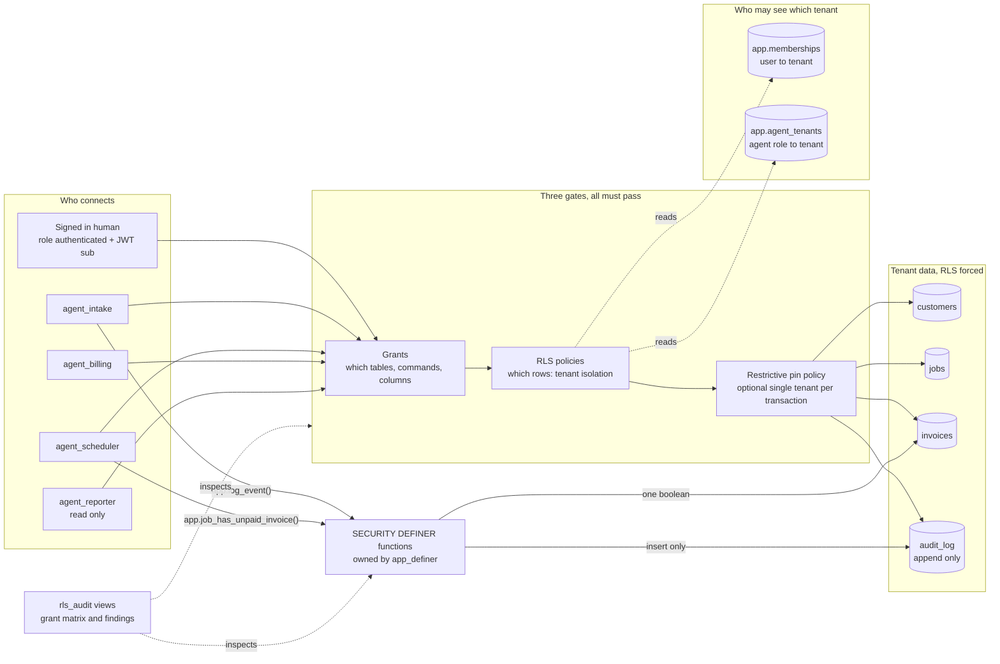

# supabase-rls-cookbook

When several automated agents and several tenants share one Postgres database, the easy path is one powerful key for everything, and then a single bug or bad prompt can read or change every tenant.
This repository is a small, tested set of recipes for the other path: one database role per agent, row level security for tenant isolation, and a query that shows who can do what.

## What it does

It is a set of plain SQL migrations for Supabase or any Postgres 15+, with tests that prove each claim.

| Recipe | Where | What you get |
| --- | --- | --- |
| One role per agent | `migrations/0001_roles.sql` | `agent_intake`, `agent_scheduler`, `agent_billing`, `agent_reporter`, plus group roles for shared grants. None can log in until you say so, none is privileged. |
| Tenant safe schema | `migrations/0003_schema.sql` | `tenant_id` on every row, composite foreign keys so a child can never point into another tenant, and a trigger that makes `tenant_id` immutable. |
| Tenant isolation policies | `migrations/0004_rls_policies.sql` | RLS enabled and forced on every table. Separate policies for signed in humans (`auth.uid()` and a membership table) and for agents (role name and an assignment table). A restrictive policy lets a multi tenant agent pin one tenant per transaction. |
| Least privilege grants | `migrations/0005_grants.sql` | Grants choose the command, policies choose the rows, column grants choose the columns. The scheduler can update two columns of a job and nothing else. |
| Read only role | `0001`, `0005` | `app_readonly` gets `SELECT` only. The reporter agent cannot write through a table or through a function. |
| SECURITY DEFINER done safely | `migrations/0006_security_definer.sql` | Two functions and the checklist they follow: unprivileged owner, empty `search_path`, no `PUBLIC` execute, caller re-checked inside, no dynamic SQL, minimal return value. |
| Grant audit | `migrations/0007_grant_audit.sql`, `queries/grant_audit.sql` | Views that list every grant, every definer function, and a `findings` view that is empty when the install is clean. The standalone query needs nothing installed. |

Each migration file starts with a comment block that explains the recipe and the reason for it. They are meant to be read.

## Architecture



## Run it

You need Python 3.10+ and Docker. Nothing is installed with pip.

```
python scripts/db.py up
python scripts/db.py test
python demo/run_demo.py
```

`up` starts a throwaway `postgres:16` container named `rls-cookbook-pg` and installs pgTAP into it with apt (this needs network access the first time). No port is published. `python scripts/db.py down` removes it.

To use an existing Postgres instead of Docker, set `PGHOST` (and the other `PG*` variables, see `.env.example`). The server needs the pgTAP extension files.

To apply the recipes to your own database, run the files in `migrations/` in order as a role that may create roles. On Supabase skip nothing: `0002_auth_shim.sql` does nothing when an `auth` schema already exists.

## Tests

There are two suites.

**pgTAP (the real tests).** 139 assertions in six files under `tests/`. They run inside Postgres, switch into each role, and check both what is allowed and what is refused.

```
python scripts/db.py test
```

| File | Checks |
| --- | --- |
| `010_structure.sql` | roles, ownership, RLS enabled and forced everywhere, no policy for `PUBLIC` |
| `020_tenant_isolation_users.sql` | owner, member, viewer, no membership, `anon` |
| `030_agent_roles.sql` | each agent's commands, rows and columns, and the tenant pin |
| `040_read_only.sql` | the reporter reads its tenants and cannot write anywhere |
| `050_security_definer.sql` | the checklist, the caller identity, the refusals |
| `060_grant_audit.sql` | clean install has no findings, ten planted mistakes are each found |

**Static checks (no database).** 28 Python `unittest` checks in `static_checks/` that read the migration files and enforce the cookbook's rules: every table enables and forces RLS, every policy names its roles, every function pins `search_path` and revokes `PUBLIC`, nothing is granted to `PUBLIC`, the read only group only gets `SELECT`, each pgTAP plan matches its assertion count, and so on.

```
python -m unittest discover -s static_checks
```

The static checks are a fast gate and a fallback for a machine with no Postgres. They can tell that a rule was followed. They cannot tell that a policy is correct. Only the pgTAP suite does that.

### What was actually run

Stated plainly, for the machine this was built on (Windows, Docker Desktop, `postgres:16` image):

- pgTAP suite: run locally in Docker mode, 139 of 139 passing.
- pgTAP suite in psql mode (the code path CI uses, `PGHOST` set, psql over TCP): run locally from inside the container, 139 of 139 passing.
- One mutation check by hand: replacing the agent select policy on customers with `using (true)` made four pgTAP assertions fail, as it should. There is no automated mutation testing.
- Static checks: run locally, all passing.
- Demo: run locally against Postgres. `demo/output.txt` is that run.
- Direct login as an agent role (no `SET ROLE`): checked once by hand to confirm `app.caller_role()` and the read only default. It is not part of the automated suite, which uses `SET ROLE`.
- `.github/workflows/ci.yml`: written to run both suites against a `postgres:16` service container. It has **not** been executed, because this repository has not been pushed anywhere.
- A hosted Supabase project: **not** tested. See limitations.

## Demo

`python demo/run_demo.py` rebuilds a demo database, loads synthetic data (three tenants, five customers), runs `demo/demo.sql` as each role in turn, and saves the result to `demo/output.txt`. The interesting part is that every block runs the same statements and gets different answers:

```
  acting_as   |           tenants           | customers |  jobs  | invoices | audit_log
--------------+-----------------------------+-----------+--------+----------+-----------
 agent_intake | north-sample, south-example | 4 rows    | 4 rows | denied   | denied

    acting_as    |   tenants    | customers |  jobs  | invoices | audit_log
-----------------+--------------+-----------+--------+----------+-----------
 agent_scheduler | north-sample | 2 rows    | 2 rows | denied   | denied
```

and the audit view catching planted mistakes:

```
 high     | definer_no_search_path   | app.sloppy()  | SECURITY DEFINER without a fixed search_path
 high     | public_table_grant       | app.leaky     | PUBLIC holds SELECT
 high     | rls_disabled             | app.leaky     | row level security is not enabled
```

The demo needs Docker with the `postgres:16` image already pulled (or `PGHOST`), and no network. It does not need pgTAP. With no database at all, `python demo/run_demo.py --static` prints a report parsed from the migration files instead and labels it as static.

## Using the recipes

Give an agent its credentials out of band, never in a migration:

```sql
alter role agent_intake login password '<from your secret manager>';
insert into app.agent_tenants (agent_role, tenant_id) values ('agent_intake', '<tenant uuid>');
```

An agent that serves several tenants should pin one per unit of work:

```sql
begin;
set local app.tenant_id = '<tenant uuid>';
-- every read and write in this transaction is now limited to that tenant
commit;
```

Run the audit whenever the schema changes, and fail the deploy if it returns rows:

```sql
select * from rls_audit.findings;
```

Adding an agent is four steps: create the role in `0001`, add it to `app_agent`, grant it the specific commands it needs, and add policies that name it for any write. The pgTAP file `030_agent_roles.sql` is the template for its tests.

Do not hand an agent the Supabase `service_role` key. That role bypasses row level security, so none of this applies to it.

## Where this pattern runs

The recipes are drawn from systems that run two small service companies day to day, where several automated agents (intake, scheduling, billing, reporting) and a handful of people share one Supabase database. Everything here was rewritten from scratch for publication: the schema is a reduced teaching version and all data is synthetic.

## Limitations

- **Not tested on hosted Supabase.** Everything was run on plain Postgres 16 with a small shim for `auth.uid()`. On Supabase the migration role is not a superuser, so ownership changes (`alter ... owner to app_owner`) depend on role membership that `0001` tries to grant but that was not verified there. Expect to adjust.
- **Agents are assumed to connect directly to Postgres** (or through a pooler) as their own role. Agents that go through the Supabase REST API with a JWT are the `authenticated` path instead, and per agent roles there need a custom `role` claim, which is not covered.
- **Connection poolers.** The tenant pin uses `set local`, which is safe in transaction pooling. Role level settings such as `default_transaction_read_only` apply at login and may not survive a pooler, which is why the read only guarantee rests on grants and not on that setting.
- **`app.caller_role()` reports the outermost role.** If one SECURITY DEFINER function calls another, the inner one still sees the original caller. That is the intended behaviour here, but it is a design choice to know about.
- **Not a performance study.** The policies use the usual initplan wrapping and tenant indexes, but nothing was benchmarked. Membership lookups run per statement.
- **The schema is small on purpose.** No soft deletes, no per row ownership inside a tenant, no storage or realtime policies.
- **The static checker is not a SQL parser.** It understands the statement shapes used in this repository. Unusual formatting can hide a statement from it, and the pgTAP suite is the authority.
- **The audit views hard code two role names** (`app_agent`, `app_readonly`) for two of the ten checks. Rename the roles and those two checks need the same rename.
- **Postgres 15 and 17 were not run.** The SQL avoids version specific features, but only 16 was tested.

## Layout

```
migrations/      0001 to 0007, applied in order
seed/seed.sql    synthetic data used by tests and demo
tests/           pgTAP
static_checks/   Python checks that need no database
queries/         standalone grant audit query
scripts/db.py    container, migrations, test runner (standard library only)
demo/            walkthrough SQL, runner, captured output
```

License: MIT, see the LICENSE file.
