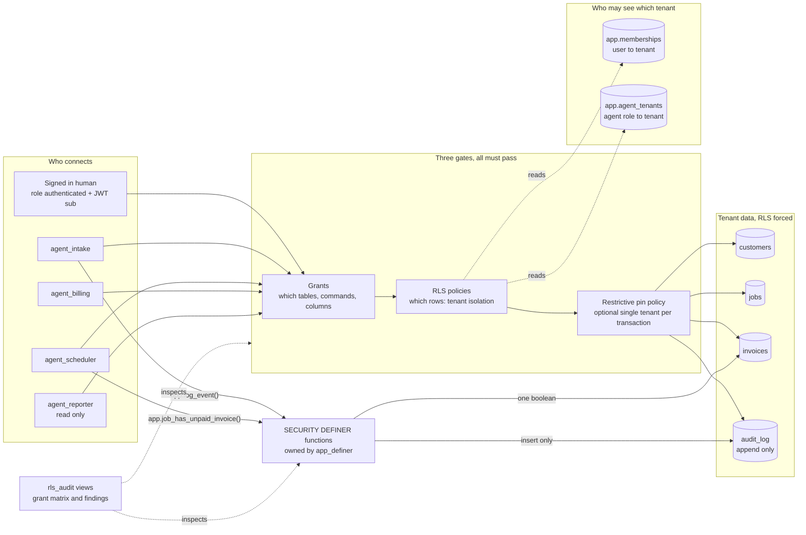

# supabase-rls-cookbook

**The problem.** Several customers (tenants) share one Supabase or Postgres database, and several automated agents or services work in it. The easy setup is one powerful key for everything. Then one bug, one leaked key or one bad prompt can read or change every customer's data.

**What this gives you.** A working, tested example of the safer setup, in plain SQL you can read in an afternoon and adapt to your own schema:

- each customer's rows are visible only to that customer's people and to the agents assigned to it,
- each agent has its own database role that can do its one job and nothing else (the scheduler can change two columns of a job, the reporter can only read),
- one query lists who can do what, and a second returns a row for every common mistake it finds (a table with no row level security, a grant to everyone, an unsafe privileged function).

**Who it is for.** A team with a multi tenant Supabase or Postgres database to lock down, or anyone reviewing how that should be done.

**How it is checked.** 141 pgTAP assertions run inside a real Postgres 16, acting as each role and checking both what is allowed and what is refused. 30 more checks read the SQL files with no database. Both suites run in GitHub Actions on every push.

**What it is not.** It has never been run against a hosted Supabase project, only plain Postgres with a small stand-in for `auth.uid()`. It is a reference to adapt, not a drop-in product. See [Limitations](#limitations).

## What you will see

Real output from `python demo/run_demo.py`, trimmed. The full run is in [`demo/output.txt`](demo/output.txt). The database holds 3 tenants and 5 customers. Each block below is the same set of queries, run as a different role:

```
  acting_as   |           tenants           | customers |  jobs  | invoices | audit_log
--------------+-----------------------------+-----------+--------+----------+-----------
 agent_intake | north-sample, south-example | 4 rows    | 4 rows | denied   | denied

    acting_as    |   tenants    | customers |  jobs  | invoices | audit_log
-----------------+--------------+-----------+--------+----------+-----------
 agent_scheduler | north-sample | 2 rows    | 2 rows | denied   | denied
```

Writes that step outside a role's job are refused by the database, not by application code:

```
 intake: add customer to unassigned tenant         | refused: new row violates row-level security policy for table "customers"
 scheduler: rename a job                           | refused: permission denied for table jobs
 billing: change an invoice amount                 | refused: permission denied for table invoices
```

The audit view, after the demo plants four mistakes on purpose (three of its eight rows):

```
 high     | definer_no_search_path   | app.sloppy()  | SECURITY DEFINER without a fixed search_path
 high     | public_table_grant       | app.leaky     | PUBLIC holds SELECT
 high     | rls_disabled             | app.leaky     | row level security is not enabled
```

And the test run (`python scripts/db.py test`):

```
tests/010_structure.sql                   28/28  ok
tests/020_tenant_isolation_users.sql      24/24  ok
tests/030_agent_roles.sql                 30/30  ok
tests/040_read_only.sql                   17/17  ok
tests/050_security_definer.sql            26/26  ok
tests/060_grant_audit.sql                 16/16  ok

6 files, 141 passed, 0 failed
RESULT: PASS
```

## What is in it

Plain SQL migrations written for Supabase or Postgres 15+ (tested on Postgres 16 only), with a test for each claim.

| Recipe | Where | What you get |
| --- | --- | --- |
| One role per agent | `migrations/0001_roles.sql` | `agent_intake`, `agent_scheduler`, `agent_billing`, `agent_reporter`, plus group roles for shared grants. None can log in until you say so, none is privileged. |
| Tenant safe schema | `migrations/0003_schema.sql` | `tenant_id` on every row, composite foreign keys so a child can never point into another tenant, and a trigger that makes `tenant_id` immutable. |
| Tenant isolation policies | `migrations/0004_rls_policies.sql` | RLS enabled and forced on every table. Separate policies for signed in humans (`auth.uid()` and a membership table) and for agents (role name and an assignment table). A restrictive policy lets a multi tenant agent pin one tenant per transaction. |
| Least privilege grants | `migrations/0005_grants.sql` | Grants choose the command, policies choose the rows, column grants choose the columns. The scheduler can update two columns of a job and nothing else. |
| Read only role | `0001`, `0005` | `app_readonly` gets `SELECT` only. The reporter agent cannot write through a table or through a function. |
| SECURITY DEFINER done safely | `migrations/0006_security_definer.sql` | Two functions and the checklist they follow: unprivileged owner, empty `search_path`, no `PUBLIC` execute, caller and tenant pin re-checked inside, no dynamic SQL, minimal return value. |
| Grant audit | `migrations/0007_grant_audit.sql`, `queries/grant_audit.sql` | Views that list every grant, every definer function, and a `findings` view with ten checks that is empty when the install is clean. The standalone query needs nothing installed. |

Each migration file starts with a comment block that explains the recipe and the reason for it. They are meant to be read.

## Run it

You need Python 3.10+ and Docker. Nothing is installed with pip.

```
python scripts/db.py up
python scripts/db.py test
python demo/run_demo.py
python scripts/db.py down
```

`up` starts a throwaway `postgres:16` container named `rls-cookbook-pg` (Docker pulls the image the first time) and installs pgTAP into it with apt, which also needs network access the first time. No port is published. `down` removes the container.

Other commands: `python scripts/db.py audit` prints the standalone grant audit for a fresh install, and `python scripts/db.py demo` prints the walkthrough without saving it.

To use an existing Postgres instead of Docker, set `PGHOST` (and the other `PG*` variables, see `.env.example`). The server needs the pgTAP extension files and a role that may create databases and roles.

To apply the recipes to your own database, run the files in `migrations/` in order as a role that may create roles. `0002_auth_shim.sql` does nothing when an `auth` schema already exists, as it does on Supabase.

## Tests

There are two suites.

**pgTAP (the real tests).** 141 assertions in six files under `tests/`. They run inside Postgres, switch into each role, and check both what is allowed and what is refused.

```
python scripts/db.py test
```

| File | Checks |
| --- | --- |
| `010_structure.sql` | roles, ownership, RLS enabled and forced everywhere, no policy for `PUBLIC` |
| `020_tenant_isolation_users.sql` | owner, member, viewer, no membership, `anon` |
| `030_agent_roles.sql` | each agent's commands, rows and columns, and the tenant pin |
| `040_read_only.sql` | the reporter reads its tenants and cannot write anywhere |
| `050_security_definer.sql` | the checklist, the caller identity, the refusals, the tenant pin inside both functions |
| `060_grant_audit.sql` | clean install has no findings, ten planted mistakes are each found |

**Static checks (no database).** 30 Python `unittest` checks in `static_checks/` that read the migration files and enforce the cookbook's rules: every table enables and forces RLS, every policy names its roles, every function pins `search_path` and revokes `PUBLIC`, nothing is granted to `PUBLIC`, the read only group only gets `SELECT`, each pgTAP plan matches its assertion count, and so on.

```
python -m unittest discover -s static_checks
```

The static checks are a fast gate and a fallback for a machine with no Postgres. They can tell that a rule was followed. They cannot tell that a policy is correct. Only the pgTAP suite does that.

### What was actually run

Stated plainly. Local runs were on Windows with Docker Desktop and the `postgres:16` image, from a freshly created container.

- pgTAP suite, Docker mode: run locally, 141 of 141 passing.
- pgTAP suite, psql mode (`PGHOST` set, psql over TCP to a `postgres:16` service container): run by `.github/workflows/ci.yml` on GitHub Actions on every push.
- Static checks: run locally and in CI, 30 of 30 passing.
- Demo: run locally and in CI. `demo/output.txt` is a local run, and a rerun reproduces it byte for byte.
- One mutation check by hand: replacing the agent select policy on customers with `using (true)` made four pgTAP assertions fail across two files, as it should. There is no automated mutation testing.
- Direct login as an agent role (password login over TCP, no `SET ROLE`): checked by hand to confirm `app.caller_role()` returns the login role and that the read only default is on. It is not part of the automated suite, which uses `SET ROLE`.
- A hosted Supabase project, or the local Supabase CLI stack: **not** run. See limitations.

## Demo

`python demo/run_demo.py` rebuilds a demo database, loads synthetic data (three tenants, five customers), runs `demo/demo.sql` as each role in turn, and saves the result to `demo/output.txt`. It has six parts: who sees which rows, which writes are refused, the tenant pin, the read only agent, the SECURITY DEFINER functions, and the grant audit before and after four planted mistakes.

The demo needs Docker (or `PGHOST`). It does not need pgTAP, and once the `postgres:16` image is on the machine it needs no network. With no database at all, `python demo/run_demo.py --static` prints a report parsed from the migration files instead, labels it as static, and saves it to `demo/output_static.txt`.

## Using the recipes

Give an agent its credentials out of band, never in a migration:

```sql
alter role agent_intake login password '<from your secret manager>';
insert into app.agent_tenants (agent_role, tenant_id) values ('agent_intake', '<tenant uuid>');
```

An agent that serves several tenants should pin one per unit of work:

```sql
begin;
set local app.tenant_id = '<tenant uuid>';
-- every read and write in this transaction is now limited to that tenant
commit;
```

Run the audit whenever the schema changes, and fail the deploy if it returns rows:

```sql
select * from rls_audit.findings;
```

Adding an agent is four steps: create the role in `0001`, add it to `app_agent`, grant it the specific commands it needs, and add policies that name it for any write. The pgTAP file `030_agent_roles.sql` is the template for its tests.

Do not hand an agent the Supabase `service_role` key. That role bypasses row level security, so none of this applies to it.

## Architecture



## Where this pattern comes from

The recipes follow the way the author runs a shared Supabase database for small service businesses, with several automated agents (intake, scheduling, billing, reporting) and a few people in it. Nothing here is copied from that system: the schema is a reduced teaching version written for publication, and all data is synthetic (`example.com` emails, `555-01xx` phone numbers).

## Limitations

- **Never run on Supabase, hosted or local.** Every test ran on plain Postgres 16. Three things stand in for Supabase there: a shim for `auth.uid()` and `auth.jwt()` (`0002`), locally created `anon` and `authenticated` roles (`0001`), and a `request.jwt.claims` setting the tests set by hand in place of a real signed JWT. No Supabase Auth, REST API, storage or realtime call was made.
- **Ownership on a managed platform is unverified.** On Supabase the migration role is not a superuser, so the ownership changes (`alter ... owner to app_owner`) depend on role membership that `0001` tries to grant. That path was not exercised. Expect to adjust.
- **Agents are assumed to connect directly to Postgres** (or through a pooler) as their own role. Agents that go through the Supabase REST API with a JWT are the `authenticated` path instead, and per agent roles there need a custom `role` claim, which is not covered. The `app` schema is also not served by the REST API unless you expose it.
- **The tenant pin is a guard rail, not a boundary.** The agent sets `app.tenant_id` itself and can clear it. It protects a well behaved agent from its own mistakes inside a transaction. The boundary against a misbehaving agent is its assignment rows and its grants.
- **Connection poolers were not tested.** The tenant pin uses `set local`, which is designed for transaction pooling. Role level settings such as `default_transaction_read_only` apply at login and may not survive a pooler, which is why the read only guarantee rests on grants and not on that setting.
- **`app.caller_role()` reports the outermost role.** If one SECURITY DEFINER function calls another, the inner one still sees the original caller. That is the intended behaviour here, but it is a design choice to know about.
- **Not a performance study.** Nothing was benchmarked and the seed data is a few rows per table. The tenant list lookups are wrapped to run once per statement. The role check used by the human write policies (`app.user_has_role`) and the pin check run per row.
- **The schema is small on purpose.** Seven tables. No soft deletes, no per row ownership inside a tenant, no storage or realtime policies.
- **The audit has ten checks and no more.** It covers table and view grants, table RLS state and SECURITY DEFINER functions. It does not judge whether a policy expression is correct, and it does not look at sequences, schema grants, default privileges or whether a view runs with its owner's rights. Two of the ten checks hard code role names (`app_agent`, `app_readonly`). Rename the roles and those two need the same rename.
- **The static checker is not a SQL parser.** It understands the statement shapes used in this repository. Unusual formatting can hide a statement from it, and the pgTAP suite is the authority.
- **Postgres 15 and 17 were not run.** The SQL avoids version specific features, but only 16 was tested.

## Layout

```
migrations/      0001 to 0007, applied in order
seed/seed.sql    synthetic data used by tests and demo
tests/           pgTAP
static_checks/   Python checks that need no database
queries/         standalone grant audit query
scripts/db.py    container, migrations, test runner (standard library only)
demo/            walkthrough SQL, runner, captured output
```

License: MIT, see the LICENSE file.
